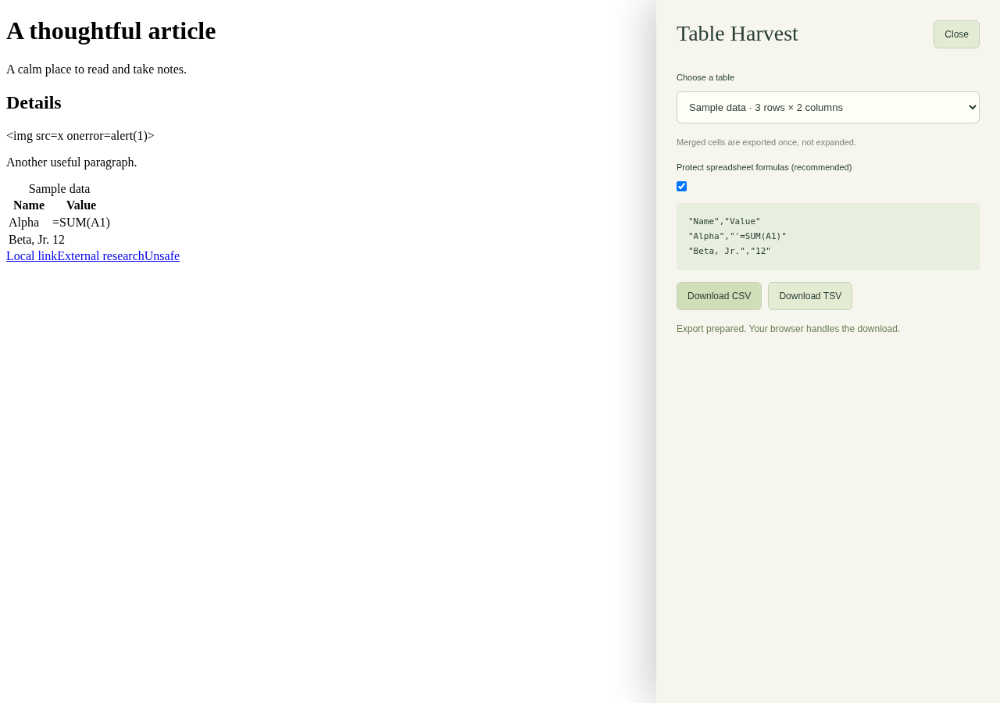

# Table Harvest

Export the tables you choose into clean, correctly escaped CSV files.

## Features

- Explicit table picker with row and column counts
- CSV quoting for commas, quotes, and line breaks
- Spreadsheet formula protection enabled by default
- Optional tab-separated export and downloads without external services

## Get started



1. Install **Tampermonkey** in a supported browser.
2. Open [`dist/table-harvest.user.js`](dist/table-harvest.user.js), select **Raw**, and accept the userscript manager’s installation prompt. Alternatively, paste the file into a new Tampermonkey script and save.
3. Visit an HTTPS page and open the Tampermonkey menu. Select the script’s command to activate it.

Nothing opens or changes page content until you choose the command. Use **Close** or **Escape** to dismiss the panel. The script matches HTTPS pages broadly because it is a general-purpose tool; you can narrow the `@match` metadata before installation if you prefer.

## Build and verify

Node.js 20+ is needed only for development. There are no package dependencies.

```sh
git clone https://github.com/oexwashere/table-harvest.git
cd table-harvest
npm run check
npm test
npm run build
```

The build combines `metadata.txt`, `src/core.js`, and `src/main.js` into a self-contained installable file in `dist/`. The generated artifact is committed so installation does not require Node. CI rebuilds and checks for drift.

Tests exercise the pure core functions. Browser checks were run in Chromium with simulated userscript APIs, covering activation, the main workflow, safe rendering, and dismissal. An actual Tampermonkey installation across arbitrary websites has **not** been verified; site-specific conflicts can still occur.

## Architecture

`src/core.js` contains the testable transformation logic. `src/main.js` contains menu registration, page extraction, and a shadow-root drawer. `metadata.txt` declares the exact userscript permissions. The script performs no analytics, external API calls, or automatic destination crawling.

CSV fields are always quoted, embedded quotes are doubled, and line breaks are preserved. Formula-like cell contents receive an apostrophe by default before export. Extraction is triggered only through the userscript menu.

## Limitations and data handling

Only actual HTML tables in the top-level page are detected. Merged cells are exported once, not expanded; virtualized rows and canvas grids are not scraped. Formula protection changes values that begin with `=`, `+`, `-`, or `@`; you can opt out when you trust the data.

## Contributing

See [CONTRIBUTING.md](CONTRIBUTING.md). Keep changes focused and include a regression test when behavior changes.

## License

[MIT](LICENSE) · oexwashere
